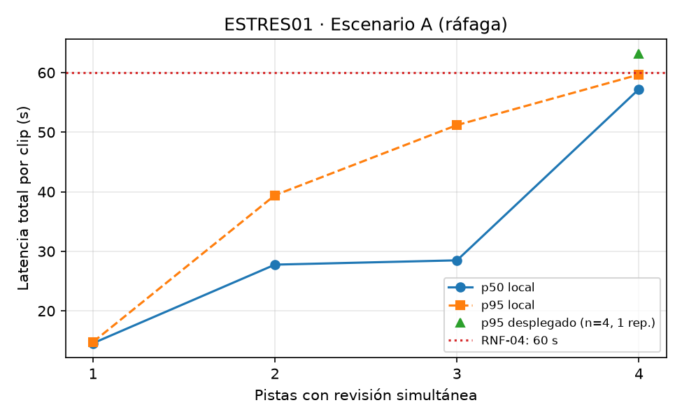

# ESTRES01 · Prueba de carga con 1 a 4 pistas (19/11/2026)

Prueba **descriptiva** aprobada por el autor; no es criterio de aceptación de la tesis. El único umbral que se
contrasta es RNF-04 (sugerencia en ≤ 60 s, p95). No se implementó soporte multipista (RF-29, F-018 y F-019 son WON'T).
Los números son **referenciales**: dependen del hardware del nodo Fog.

## 1. Método

- **Equipo:** MacBook Air Apple M4, 10 núcleos, 16 GB, sin GPU usada (`FOG_DEVICE=cpu`, YOLOv8x-pose).
- **Clips:** 12 originales de `dataset raw/test` (≈ 300 fotogramas), fijados en `scripts/estres/clips.json` (generado con
  `scripts/estres/armar_clips.py`). Fog los recorta a la ventana de DEF-32 (76 fotogramas; `RiposteB_0062` es de 60 fps,
  así que son **151**). Cada pista sube siempre los mismos 3 clips en el mismo orden (P1: AttackA_0023, RiposteA_0055,
  ContrattackB_0001; P2: AttackB_0006, RiposteB_0062, ContrattackA_0002; P3: ContrattackA_0005, AttackA_0007, RiposteA_0021;
  P4: ContrattackB_0015, AttackB_0016, RiposteB_0004).
- **Supuesto sobre las luces:** las luces anotadas están en fotogramas del clip *trimmed*; en el original se derivaron como
  `round(fi·fps/24) + luz_trimmed` (`fi` de `trim_summary.csv`). Los instantes no entran a las features, solo centran la
  ventana. Los brazos armados salen de Label Studio, como en `prueba_humo.py`. La selección de los 12 clips es del asistente
  (extiende la de DEPLOY10); el autor puede cambiarla.
- **Script:** `scripts/estres/carga.py` (asyncio + httpx), un login por corrida, un combate por pista. La latencia es la del
  cliente: desde que envía el clip hasta recibir la sugerencia (incluye la subida).
- **Etapas:** logs de tiempo con `ESTRES_TIEMPOS=1` (`shared/tiempos.py`, sin cambio de lógica) unidos con `desglosar.py`.
  «cola executor» = espera de un hilo del `ThreadPoolExecutor(max_workers=2)` de Fog, antes de leer el clip y antes de
  `finish()`; «cola YOLO» = espera del `threading.Lock` de `model.predict()`; «pose» = predict + tracking + lectura del
  clip; «espera Cloud» = de publicar a recibir el veredicto, menos la clasificación; «clasificación» =
  `latencia_inferencia_ms` que informa Cloud; «resto» = recorte, guardado, base y respuesta. Las etapas son **medias por
  solicitud**; en las solicitudes con timeout faltan los datos de Cloud, por lo que sus medias cubren solo las que los tienen.
- **Escenario A (ráfaga):** 1, 2, 3 y 4 pistas suben su clip en el mismo instante; 3 repeticiones, intercaladas
  (repetición por fuera, pistas por dentro) para no confundir la deriva térmica con el número de pistas.
- **Escenario B (sostenido):** 4 pistas, 10 min, 3 repeticiones, intervalo exponencial de **media 30 s** (decisión del
  autor: «hasta 2 solicitudes por minuto por pista, no fijo»; es la carga máxima). El intervalo corre desde que la pista
  recibe su sugerencia hasta su siguiente solicitud (una pista no tiene dos revisiones abiertas).
- **Entorno local:** Fog nativo (:8021), Cloud en Docker (`sabre-cloud:local`), Redis y PostgreSQL de Docker, base
  `sabre_estres`. **Desplegado:** Cloud y frontend en Railway por la tailnet (DEPLOY09), Fog nativo en modo remoto contra
  `sabre_estres` (con credenciales desechables), 4 pistas, 1 repetición, precedida de una corrida de calentamiento de 1 pista
  (22,2 s, no incluida en la tabla).

## 2. Resultados

### A local (ráfaga)

| Pistas | n | p50 (s) | p95 (s) | máx (s) | No disponibles | > 60 s | subida | cola executor | cola YOLO | pose | features | espera Cloud | clasificación | resto | CPU Fog máx | RAM Fog máx (MiB) |
|---|---|---|---|---|---|---|---|---|---|---|---|---|---|---|---|---|
| 1 | 3 | 14.6 | 14.8 | 14.8 | 0 | 0 | 0.01 | 0.00 | 0.00 | 13.51 | 0.01 | 0.00 | 0.01 | 0.47 | 390 % | 883 |
| 2 | 6 | 27.8 | 39.4 | 43.1 | 0 | 0 | 0.01 | 0.00 | 12.17 | 16.18 | 0.01 | 0.00 | 0.01 | 0.80 | 880 % | 1179 |
| 3 | 9 | 28.5 | 51.2 | 57.3 | 0 | 0 | 0.01 | 8.93 | 8.64 | 15.46 | 0.01 | 0.01 | 0.01 | 1.08 | 935 % | 1232 |
| 4 | 12 | 57.2 | 59.7 | 62.2 | 1 | 1 | 0.02 | 26.77 | 12.84 | 14.29 | 0.01 | 0.02 | 0.01 | 1.37 | 912 % | 1577 |

### B local (sostenido, 10 min × 3 repeticiones)

| Pistas | n | p50 (s) | p95 (s) | máx (s) | No disponibles | > 60 s | subida | cola executor | cola YOLO | pose | features | espera Cloud | clasificación | resto | CPU Fog máx | RAM Fog máx (MiB) |
|---|---|---|---|---|---|---|---|---|---|---|---|---|---|---|---|---|
| 4 | 110 | 39.0 | 59.4 | 76.2 | 6 | 6 | 0.01 | 11.05 | 10.48 | 14.95 | 0.24 | 0.01 | 0.01 | 0.59 | 874 % | 1384 |

### A desplegado (ráfaga, 4 pistas, 1 repetición)

| Pistas | n | p50 (s) | p95 (s) | máx (s) | No disponibles | > 60 s | subida | cola executor | cola YOLO | pose | features | espera Cloud | clasificación | resto | CPU Fog máx | RAM Fog máx (MiB) |
|---|---|---|---|---|---|---|---|---|---|---|---|---|---|---|---|---|
| 4 | 4 | 62.4 | 63.2 | 63.3 | 3 | 4 | 0.75 | 27.66 | 13.44 | 14.57 | 0.02 | 2.74 | 1.50 | 2.77 | 860 % | 1132 |

Tiempos en segundos; CPU de Fog como % de un núcleo (máximo posible 1000 %). Latencia de inferencia local: ~10 ms.

**Recursos máximos locales** (escenario B): Fog 874 % de CPU y 1384 MiB; Cloud 5 % y 160 MiB; Redis 3 % y 12 MiB;
PostgreSQL 3 % y 70 MiB (contenedor compartido con `sabre_expo`, en reposo). `fog:features`: XLEN llegó a 100 (= `STREAM_MAXLEN`;
el stream conserva entradas ya confirmadas, así que **no mide cola**); el rezago del grupo de Cloud y sus pendientes fueron
**0** en todas las corridas: Cloud nunca acumuló trabajo. **No se midieron** CPU y RAM de Cloud en Railway ni de Redis nativo
en el desplegado (sin acceso desde el cliente sin manejar credenciales); en el desplegado solo hay datos de Fog y PostgreSQL.

**Costo Railway:** `railway usage` informa $0,0954 acumulado del periodo (8/11–8/12), con $0,1907 estimado; no se registró el valor previo,
así que **no es el delta de esta prueba**. Los despliegues de esta prueba quedaron en `REMOVED`.

## 3. Conclusión

**¿4 pistas cumplen RNF-04 en el p95? No de forma fiable.**
- *Ráfaga local, 4 pistas:* p95 = 59,7 s, es decir, 0,3 s bajo el límite, con n = 12 (el p95 depende del segundo valor más
  alto); máximo 62,2 s y 1 de 12 clips «no disponible» (timeout). Con 1 pista el p95 es 14,8 s (cumple con holgura); con 3, 51,2 s.
- *Sostenido, 4 pistas, 30 s:* p95 = 59,4 s, máximo 76,2 s; **6 de 110 (5,5 %)** solicitudes pasaron de 60 s y fueron «no
  disponibles». Cuatro de las seis son el clip de 60 fps (151 fotogramas, ≈ 28 s solo en el lock) y dos son `AttackB_0006`.
  El p95 queda al borde y depende de la mezcla de clips.
- *Desplegado, 4 pistas (1 repetición):* los 4 clips superaron los 60 s (61,1–63,3 s) y 3 de 4 salieron «no disponibles».
  La pose termina cerca de los 56 s y a Cloud le quedan 3–4 s del presupuesto de 60 s de Fog: con Cloud en Railway la
  clasificación tarda 1,5 s (≈ 10 ms local) y la espera 0,5–4 s, y tres veredictos simultáneos no caben. Es una sola repetición.

**Cuello de botella medido: YOLO en la CPU de Fog, serializado por su lock; Cloud y la red solo importan en el borde.**
1. *El lock se confirma:* con 1 pista la pose tarda ≈ 13,5 s (≈ 181 ms por fotograma); la latencia del último clip crece
   casi linealmente (14,6 → ≈ 28 → ≈ 43 → ≈ 57 s para 1 → 4 pistas, es decir ≈ n × 14 s) y la «cola YOLO» media pasa de 0 a 8–13 s.
2. *CPU:* con un solo clip Fog ya usa ≈ 390 % y con 2 o más ≈ 900 % de 1000 %. Por eso **quitar solo el lock probablemente no
   aceleraría** (los predicts compartirían los mismos 10 núcleos). Es una **hipótesis, no se midió** sin el lock.
3. *Segundo punto de serialización no previsto:* el `ThreadPoolExecutor` de Fog tiene `max_workers=2`
   (`fog/composition.py:133`). Con 4 clips, 2 esperan un hilo antes de empezar (cola executor media 26,8 s con 4 pistas), y
   además `finish()`, que no calcula nada, hace cola detrás de los clips de las otras pistas: en el desplegado P1 y P3 terminaron
   la pose a ≈ 28 s pero respondieron a ≈ 57 s (`finish_y_guardado_s` = 27,8 s). Por eso con 4 pistas el p50 (57,2 s) casi iguala al
   último clip, y con 2 pistas es 27,8 s. Es una inferencia de los logs de tiempo; no hubo una corrida contrafactual.
4. *Cloud y red:* local, features + Redis + clasificación suman < 0,1 s por clip (rezago 0). Subida: 0,75 s con 4 clips
   simultáneos por internet. No son el cuello, salvo la cola de 3–4 s de Cloud en Railway al final del presupuesto.

## 4. Opciones para bajar la latencia (no implementadas)

Cada una debe pasar `probar` (DEPLOY10, equivalencia de salidas) antes de usarse. Ninguna se midió aquí, salvo la RAM de la tercera.

| Opción | Costo | Riesgo de fidelidad | Efecto esperado |
|---|---|---|---|
| Cola con prioridad por orden de llegada (reemplaza el reparto por fotograma del lock) y `finish()` fuera del executor de 2 hilos | Bajo: cambio dentro del adaptador y de `clip_file_reader`, sin dependencias | Ninguno: mismo cómputo y mismas features | No baja el último clip (≈ n × 14 s) pero sí el p50 y la equidad: la primera pista en llegar respondería a ≈ 14 s y no a ≈ 28–57 s |
| MPS o GPU (`FOG_DEVICE=mps`) | Sin código (DEPLOY10 ya lo admite); depende del hardware | **Medio:** pueden cambiar las features por aritmética distinta; exige repetir `probar` y comprobar la cota de equivalencia | Posible aceleración del `predict` (≈ 14 s por clip); no medida |
| Una instancia de YOLO por pista | Memoria medida: 1 instancia 883 MiB y 4 instancias 1420 MiB de RSS del proceso (≈ +180 MiB por instancia extra, con ruido); más código en `composition.py` | Ninguno si el tracker sigue por sesión | Bajo si la CPU ya está saturada (≈ 900 %): hipótesis, no medida |
| Menos fotogramas por clip | Proporcional: 76 → 38 fotogramas ≈ la mitad del tiempo de pose | **Alto:** cambia la ventana de D-19 y la distribución de entrada del modelo; requiere nueva validación (y quizá reentrenamiento) | ≈ −50 % de latencia, pero con riesgo de F1 y κ; no recomendable sin aprobación del autor |

## 5. Limitaciones

- Una sola repetición en el desplegado; los p95 con n = 4 a 12 son poco estables.
- El clip de 60 fps pesa el doble y explica casi todos los timeouts; con otra mezcla de clips los porcentajes cambian.
- Cloud local compartió CPU con Fog en el mismo Mac (2–5 %); la CPU de Fog se midió con `psutil` y los contenedores con `docker stats` en continuo (refresco de 1 a 2 s).
- Las instrumentaciones estaban sin commitear cuando se midió el desplegado (el bloqueo `probar` va por commit); solo escriben logs con `ESTRES_TIEMPOS=1`.
- Durante el desplegado se detuvo el Fog de `sabre_expo` y se relanzó igual (`.secrets/fog_remoto.env --remoto`); su `/health` respondió ok después.
- Datos por solicitud, resúmenes y CSV de recursos en `docs/evidencia/estres/datos/`. Los logs de Fog (con rutas locales) no se conservan.
