# Manual de usuario de SABRE.AI

Para el árbitro y el operador que usan la interfaz web. La instalación está en [`GUIA_INSTALACION.md`](GUIA_INSTALACION.md), el arranque en [`GUIA_EJECUCION.md`](GUIA_EJECUCION.md) y lo que el sistema no hace, en [`LIMITACIONES.md`](LIMITACIONES.md).

**Las capturas son reales.** Se tomaron en la ejecución de verificación de DOC01: instalación en limpio, Fog, Cloud y base reales, sin API simulada ni datos de prueba, con clips de sable del autor analizados por el sistema. **El área del video aparece en negro a propósito:** los clips son de competencia y sus derechos de imagen no son del autor, así que las capturas no muestran fotogramas de atletas. Los trazos de pose (que no son imagen de video) sí se muestran. Los alias, el árbitro y el evento son los precargados por la instalación o los de una sesión de ejemplo.

## 1. Propósito y alcance

SABRE.AI clasifica la acción táctica de un tocado de sable en 6 clases y entrega una **sugerencia** con su porcentaje de confianza. **El sistema solo sugiere. El árbitro decide**, y el sistema no asigna puntos ni cierra una revisión sin la decisión del árbitro (RNF-01).

La validación del sistema es una sola: el árbitro revisa clips cargados en la interfaz y se mide el acuerdo sistema-árbitro (κ de Cohen). Usted carga el clip y marca el instante de cada luz.

Esta versión **no captura video en tiempo real, no lee el aparato Favero ni tiene botón "Solicitar VAR", lista de tocados o decisión en pista**: todo eso salió de `main` por la solicitud de cambio del 20/11/2026 (D-12; está en la rama `future/edge-favero`). En `main` el clip se carga a mano y "ANALIZAR" abre la revisión (el sistema no registra qué tirador la pidió, D-04). Ver el Anexo B.

## 2. Acceso e inicio de sesión

El sistema tiene **un usuario maestro único**, el que se creó al instalar (`AUTH_USER` y su contraseña, [`GUIA_INSTALACION.md`](GUIA_INSTALACION.md), sección 6). Toda pantalla exige iniciar sesión.

1. Abra un navegador web de escritorio (se probó con Google Chrome) y escriba la dirección de la interfaz. Con la instalación de la guía es `http://localhost:8081`.
2. Debe verse la pantalla **"Iniciar sesión"** con los campos "Usuario" y "Contraseña" y el botón "Ingresar".

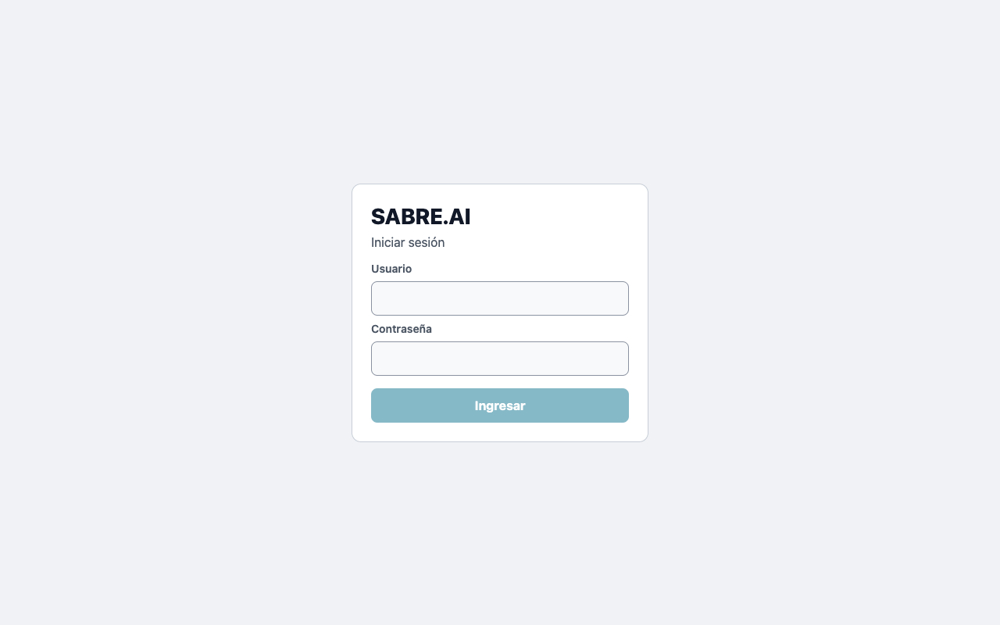

3. Escriba usuario y contraseña y pulse **Ingresar** ("Ingresando…" mientras responde). Entra a **Revisión VAR**.

Si los datos son incorrectos aparece **"Usuario o contraseña incorrectos."**, sin decir cuál campo falló; si Fog no responde, "No se pudo conectar con el servidor.". **Tras 5 intentos fallidos en 15 minutos el acceso desde esa dirección se bloquea durante 15 minutos**, aunque luego escriba la contraseña correcta (mensaje: "Demasiados intentos fallidos. Intente de nuevo en N min."). La sesión dura 8 horas y se pierde al cerrar la pestaña; si caduca, la interfaz vuelve sola al inicio de sesión. Para salir, pulse **Cerrar sesión** en el encabezado (esto cierra *su acceso*; no es lo mismo que "Cerrar sesión de validación", sección 4.9).

### El encabezado

Contiene los botones **Revisión VAR**, **Historial** y **Combate**; con un combate activo agrega "Pista", "Árbitro:" y **Finalizar combate**; luego el texto "Modelo activo:" con el nombre de la versión del modelo (se lee del sistema: si la consulta falla, no se muestra), el indicador de estado, el botón de tema ("Tema claro" o "Tema oscuro") y **Cerrar sesión**.

### Indicador de estado

Consulta el estado del sistema cada 10 segundos (`GET /health`).

| Texto | Significado | Qué hacer |
|---|---|---|
| "Verificando" | Aún no hay respuesta. | Espere unos segundos. |
| "Conectado" | Fog, Redis y PostgreSQL responden. | Continúe. |
| "Degradado" | Al menos uno de los tres componentes falla. | No inicie una sesión. Avise a quien instala el sistema (`GUIA_EJECUCION.md`, solución de problemas). |
| "Sin conexión" | Fog no responde. | Compruebe que Fog esté en marcha y avise a quien instala el sistema. |

## 3. Flujo de una sesión

Siete pasos: configurar el combate, cargar el clip, analizar, revisar la sugerencia (y su interpretación), registrar la decisión, consultar el historial y cerrar la sesión. Los pasos 2 a 5 se repiten por cada clip. Un combate admite cualquier número de clips y cada clip abre su propia revisión.

## 4. Pasos

### 4.1 Configurar el combate (CU-01, F-039)

1. Pulse **Combate**. El título es "Configurar combate" (o "Nuevo combate" si ya hay uno activo).
2. **Evento:** vienen "Validación 1" y "Evento de prueba" desde la instalación; "Validación 1" viene seleccionado. Cada opción muestra nombre y fecha. Para otro evento, ver `GUIA_EJECUCION.md` (crear una sesión).
3. **Pista:** viene con "P1". Edítela si es otra.
4. **Árbitro:** viene seleccionado si hay uno solo; si hay varios, elija el del combate.
5. En la tarjeta **Tirador ROJ** (A), "Alias" es opcional; si lo deja vacío se usa "Tirador A". Use siempre alias, nunca nombres de atletas.
6. **Brazo armado:** pulse "Diestro" o "Zurdo". Es **obligatorio y no tiene valor por defecto**: las características del movimiento se calculan sobre ese brazo.
7. Repita 5 y 6 en **Tirador VER** (B; alias por defecto "Tirador B").
8. Pulse **Crear combate** (atajo Ctrl+Intro). Debe aparecer la tarjeta **Combate activo** con la pista, el árbitro y los alias, y el encabezado muestra "Pista" y "Árbitro:".

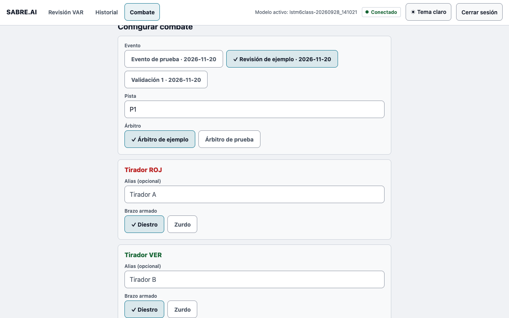

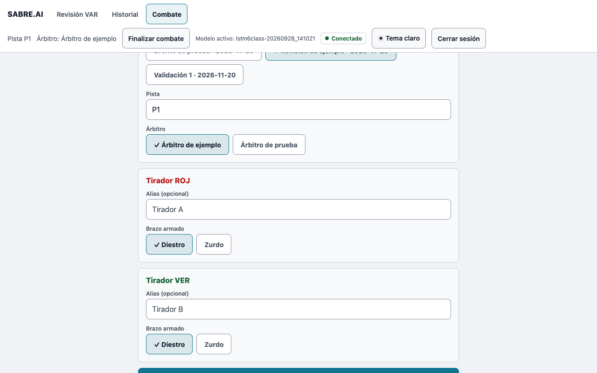

A es el tirador **ROJ** (izquierda en cámara) y B es el tirador **VER** (derecha en cámara). Esta asignación es fija. El consentimiento informado se gestiona en papel, fuera del sistema. El combate activo se conserva si recarga la página; si ya no existe en el sistema, se descarta.

Si falta un dato, la pantalla no crea el combate y muestra uno de estos mensajes, con "Corrige el dato y vuelve a pulsar Crear combate.":

| Mensaje | Causa |
|---|---|
| "Falta seleccionar el evento" | No eligió un evento. |
| "Falta la pista" | El campo "Pista" está vacío. |
| "Falta seleccionar el árbitro" | No eligió un árbitro. |
| "Falta el brazo armado del tirador A" (o B) | No eligió "Diestro" o "Zurdo". |

Si la lista de eventos o de árbitros no carga, aparece "No se pudo cargar el catálogo" con el botón "Reintentar", o "No hay eventos registrados", "No hay árbitros registrados" o "No hay eventos ni árbitros registrados" con el botón "Recargar". No se puede crear el combate hasta que el catálogo cargue.

Sin combate activo, **Revisión VAR** muestra "No hay combate activo" y el botón "Configurar combate"; **Historial**, "No hay un evento activo".

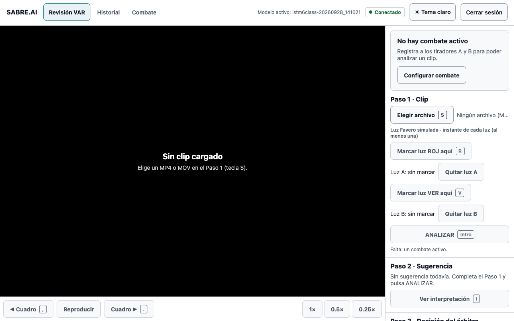

### 4.2 Cargar el clip y marcar las luces (CU-02, CU-03)

El clip es un MP4 o MOV de sable de ≥ 720p. No hay lista de tocados: usted carga un clip por revisión.

1. Pulse **Revisión VAR**. En **Paso 1 · Clip**, pulse **Elegir archivo** (atajo S) y elija el archivo. El nombre aparece junto al botón y el clip se muestra en el reproductor.
2. Con el reproductor, lleve el clip al instante en que se encendió la luz de A. Puede usar "Reproducir" o "Pausa", "◀ Cuadro" (atajo coma), "Cuadro ▶" (atajo punto) y las velocidades "1×", "0.5×" y "0.25×".
3. En "Luz Favero simulada · instante de cada luz (al menos una)", pulse **Marcar luz ROJ aquí** (atajo R). Debe verse el instante en milisegundos, por ejemplo "Luz A: 3633 ms". Antes de marcar se lee "Luz A: sin marcar".
4. Si también se encendió la luz de B, lleve el reproductor a su instante y pulse **Marcar luz VER aquí** (atajo V). En un tocado doble las dos luces pueden encenderse con algunos fotogramas de diferencia: marque cada una en su propio instante. Para deshacer, "Quitar luz A" o "Quitar luz B".

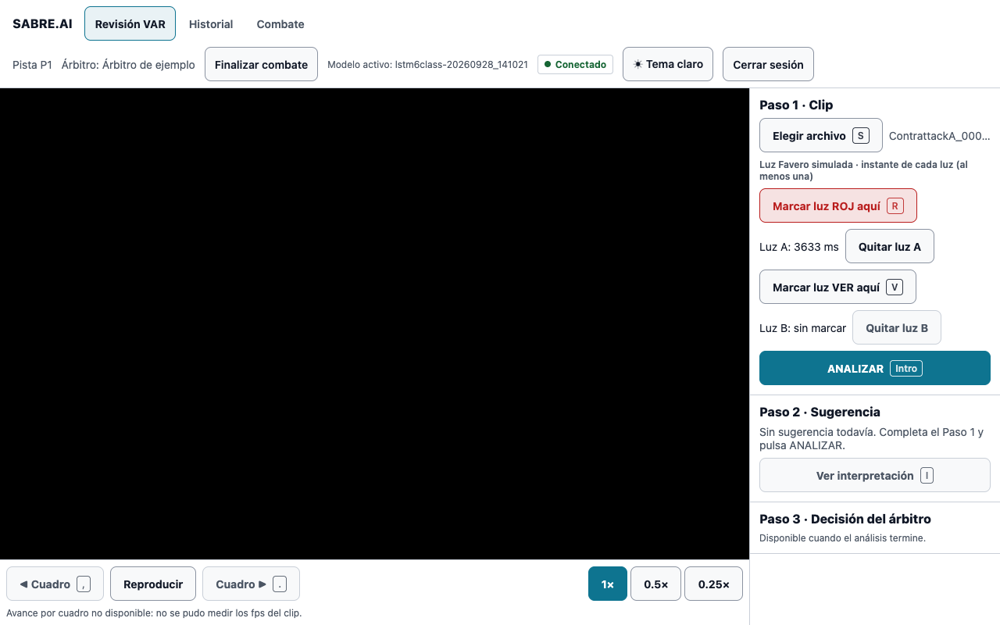

Al elegir otro archivo, las dos luces vuelven a "sin marcar" y se descarta el resultado anterior. Una luz sin marcar se envía como apagada. El instante de la luz sirve para centrar la ventana del clip: **2,0 s antes y 0,5 s después** del primer instante marcado (D-19). Una luz mal marcada cambia la sugerencia (el filtro Favero descarta las clases del tirador sin luz).

**ANALIZAR** queda desactivado hasta completar los requisitos. Debajo aparece "Falta: un combate activo.", "Falta: elegir un clip." o "Falta: marcar la luz A o la luz B."

Si el navegador no puede medir los fps del clip, bajo el reproductor aparece "Avance por cuadro no disponible: no se pudo medir los fps del clip." y los botones de cuadro quedan desactivados; el resto funciona.

### 4.3 Solicitar la revisión y esperar la sugerencia (CU-05)

1. Pulse **ANALIZAR** (atajo Intro). Abre la revisión del clip. El sistema no registra qué tirador la pidió.
2. Espere. El botón cambia a "Analizando…" y aparece "Analizando… N s de 60 s". La latencia objetivo es de 60 segundos como máximo; en un equipo de referencia un clip tarda unos 15 s ([`LIMITACIONES.md`](LIMITACIONES.md), sección 2).
3. Debe verse **✓ Listo** y el **Paso 2 · Sugerencia** con el resultado.

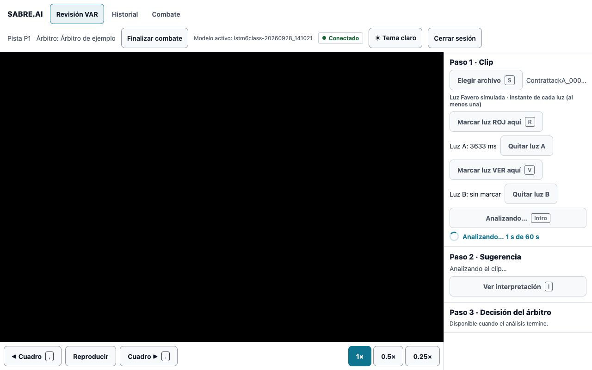

Si pasan 60 segundos sin respuesta, la pantalla muestra "Clasificación no disponible" con el motivo `timeout` (sección 5) y usted sigue el procedimiento VAR habitual. Si el sistema rechaza el clip o no hay conexión, aparece "Error: no se pudo analizar el clip", el detalle y el botón "Reintentar"; en ese caso no se abre revisión.

### 4.4 Revisar la sugerencia

El **Paso 2 · Sugerencia** muestra, bajo "Sugerencia del sistema":

- La acción: "Ataque", "Contraataque" o "Riposte".
- El tirador atribuido: "ROJ" (A) o "VER" (B).
- La **Confianza** en porcentaje, con una barra.
- Una **insignia de razonamiento** (sección 4.5) y una frase que resume la evidencia, con el botón **Ver interpretación** (atajo I).

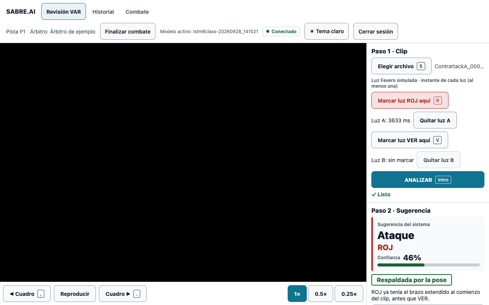

Si el sistema no puede clasificar, el paso muestra **"Clasificación no disponible"**, el motivo y "Continúe con el procedimiento VAR habitual." Los motivos están en la sección 5.

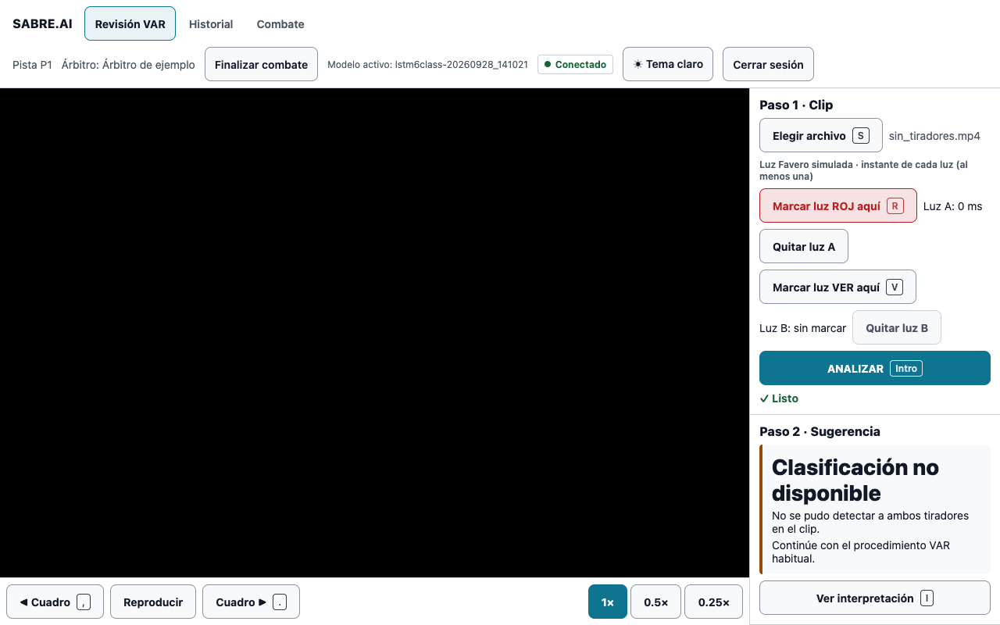

### 4.5 Ver la interpretación: trazos y razonamiento (CU-08, CU-09)

Pulse **Ver interpretación** (atajo I; también T abre los trazos y J el razonamiento). Se abre una vista, "Interpretación · Apoyo a la sugerencia: la decisión es del árbitro.", con dos partes. Se cierra con **Cerrar** (Esc).

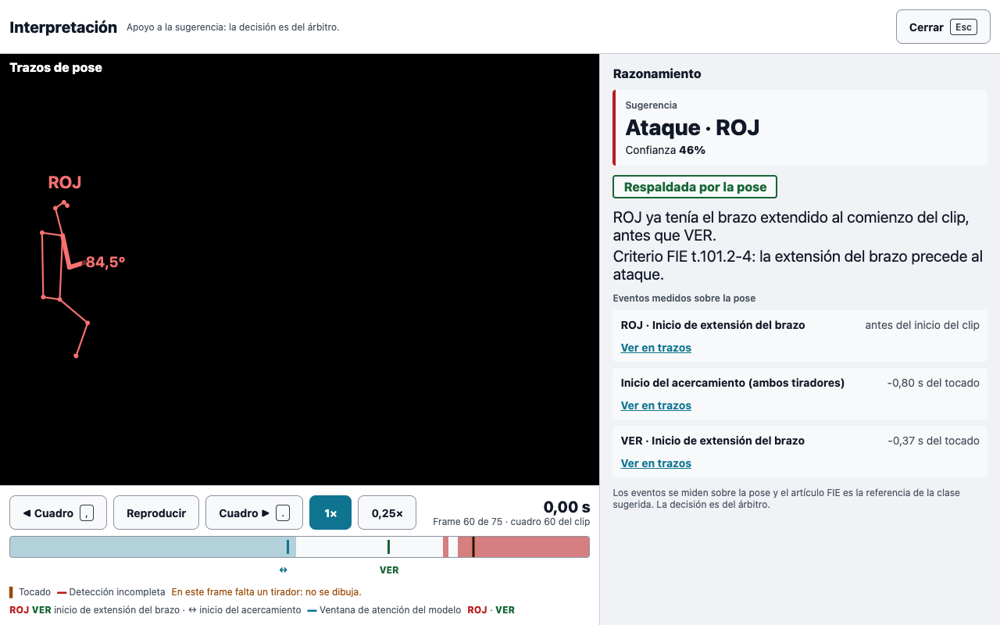

**Trazos de pose** (a la izquierda, sobre fondo negro, **sin video**): el esqueleto de ambos tiradores (ROJ y VER), el ángulo del codo, la extensión del brazo y la trayectoria de las extremidades. **No se dibuja la línea del arma**: el detector no ve la hoja y el sistema no dibuja trazos inventados ([`LIMITACIONES.md`](LIMITACIONES.md), sección 5). Debajo hay controles: "Reproducir", "◀ Cuadro" y "Cuadro ▶" (atajos coma y punto), velocidades "1×" y "0,25×", y una barra de tiempo con el cuadro actual ("Frame N de M") y marcas para el **tocado**, el inicio de extensión del brazo de cada tirador, el inicio del acercamiento y la **ventana de atención del modelo**.

**Razonamiento** (a la derecha): la sugerencia con su confianza; una **insignia** con el estado de la evidencia; frases que explican la sugerencia; el criterio FIE de referencia (por ejemplo "t.105"); y los "Eventos medidos sobre la pose", cada uno con su tiempo respecto del tocado y un enlace **Ver en trazos** que mueve el cursor de los trazos a ese instante. Termina con la nota "Los eventos se miden sobre la pose y el artículo FIE es la referencia de la clase sugerida. La decisión es del árbitro."

| Insignia | Significado |
|---|---|
| "Respaldada por la pose" | Los eventos medidos sobre la pose respaldan la sugerencia. |
| "Evidencia discordante" | La pose indica otra cosa que la sugerencia (por ejemplo, que el otro tirador extendió el brazo primero). Revise el video antes de decidir. |
| "No concluyente" | La pose no basta para respaldar ni contradecir la sugerencia. |
| "Evidencia insuficiente" | No hay evidencia suficiente para sostener la sugerencia. |

El razonamiento es **determinista**: plantillas fijas con la atención del modelo y eventos medidos sobre la pose, sin LLM (D-15). Se calcula al clasificar y se guarda con la revisión. Las revisiones anteriores a F-035 muestran "Esta revisión es anterior al registro de razonamiento." y no se recalculan. Si no se pudo calcular, "No se pudo calcular el razonamiento de esta sugerencia."

Casos especiales de los trazos: "No hay trazos: la pose no se extrajo" (la clasificación no tuvo pose), "Detección incompleta" en los cuadros sin ambos tiradores, "El clip no tiene frames con ambos tiradores detectados." y "Los keypoints de esta revisión no pasan la verificación de integridad": en ese caso **no se dibuja nada** para no mostrar datos alterados, y se sigue el procedimiento VAR habitual. Si la revisión aún no tiene clasificación, la vista dice "Esta revisión aún no tiene una clasificación registrada". Cada parte tiene su botón "Reintentar" si falla la carga.

### 4.6 Registrar la decisión (CU-10, F-033)

El **Paso 3 · Decisión del árbitro** se activa cuando el análisis terminó y hay una revisión abierta. Usted declara siempre la clase final entre las 6 o anula la acción. La sugerencia del sistema aparece destacada ("Sugerencia del sistema") pero **nunca viene elegida**.

1. Revise el video, la sugerencia y, si quiere, la interpretación.
2. Responda **¿Modifica la clase sugerida?** ("Sí" o "No"). No tiene respuesta por defecto. "No" mantiene la clase sugerida; "Sí" le deja elegir otra.
3. Si respondió "Sí", elija la **Clase final (elige una de las 6)**. Con el botón aparte **Anular la acción** (atajo A) registra la anulación, sin clase final (acción simultánea, FIE t.106); en ese caso no hace falta responder la pregunta.
4. Lea el **Resumen antes de registrar** (por ejemplo "Cambia la decisión en pista · clase final: Ataque · ROJ") y pulse **Confirmar y registrar**. Está desactivado mientras falte algo; debajo aparece "Falta:" con lo que falta. **Borrar elección** (atajo Esc) deja todo sin elegir.
5. Debe verse **✓ Veredicto registrado** con "Mantiene", "Cambia" o "Anula" y, si corresponde, la clase final.

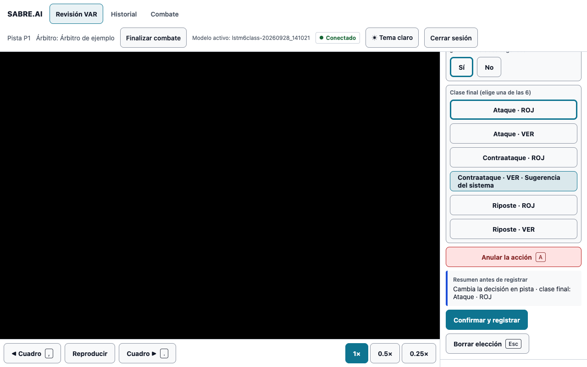

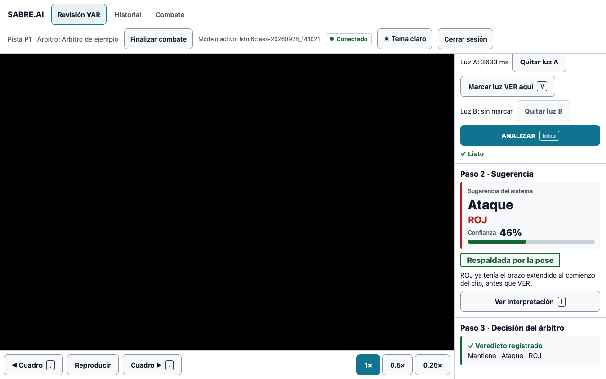

Si la sugerencia no estuvo disponible, el selector muestra las 6 clases sin marca y usted decide igual. **Una vez registrada, la decisión no se puede editar**: el selector desaparece y el sistema rechaza un segundo veredicto sobre la misma revisión (error 409). Los registros son de solo adición (RNF-05). Si el registro falla, aparece "No se pudo registrar el veredicto" con "Revisa tu decisión y vuelve a confirmarla." Si no hay revisión abierta: "No hay revisión abierta: continúe con el procedimiento VAR habitual." Antes de terminar el análisis: "Disponible cuando el análisis termine."

### 4.7 Historial (CU-12)

1. Pulse **Historial**. Con combate activo, el título es "Revisiones del evento" seguido del número de revisiones, de la más reciente a la más antigua, solo las del evento del combate activo.
2. Lea la línea de resumen de la sesión, sobre la lista: por ejemplo "Validación · 3 revisiones · κ 0.00 (leve) · latencia p95 > 60 s". Aparece solo si el evento tiene revisiones con veredicto. Si κ no es calculable, la línea lo omite. Una revisión sin sugerencia cuenta como más de 60 s: basta que más del 5 % de las revisiones no tenga sugerencia para que aparezca "latencia p95 > 60 s".

| Columna | Contenido |
|---|---|
| Fecha y hora | Momento en que se abrió la revisión. |
| "Sugerencia" | Acción y tirador (por ejemplo "RIPOSTE · ROJ") o "No disponible". |
| "Confianza" | Porcentaje de la sugerencia; "—" si no hubo. |
| "Veredicto del árbitro" | "Mantiene", "Cambia" o "Anula", con la clase final si existe, o "Pendiente". |
| "Concordancia" | "Coincide" si la clase sugerida es igual a la final, "Difiere" si no; "—" si no hubo sugerencia, no hay veredicto o se anuló. |

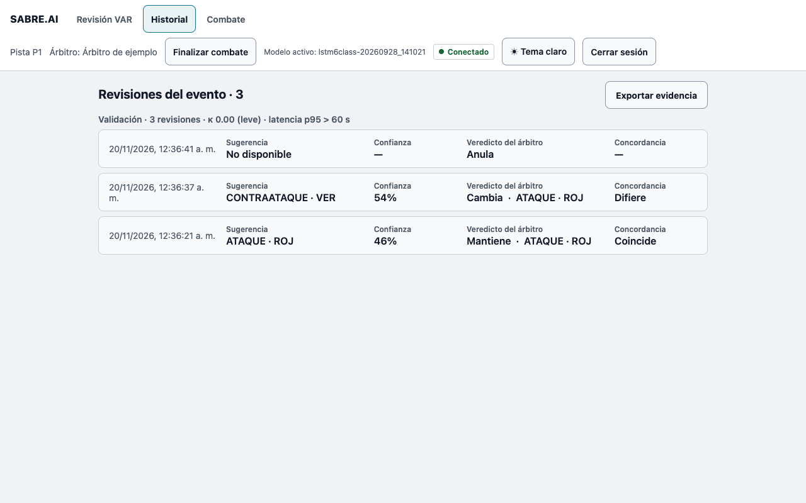

3. Pulse una fila para abrir el detalle (otra vez para cerrarlo): "Sugerencia del sistema" (clase, tirador y confianza; o "Clasificación no disponible" con el motivo; o "Aún sin clasificación"), las probabilidades de las 6 clases, "Decisión del árbitro" con su fecha ("Registrada:"), el botón **Ver interpretación** y "Auditoría": "Registro n.º" y el código de integridad (hash) del registro.

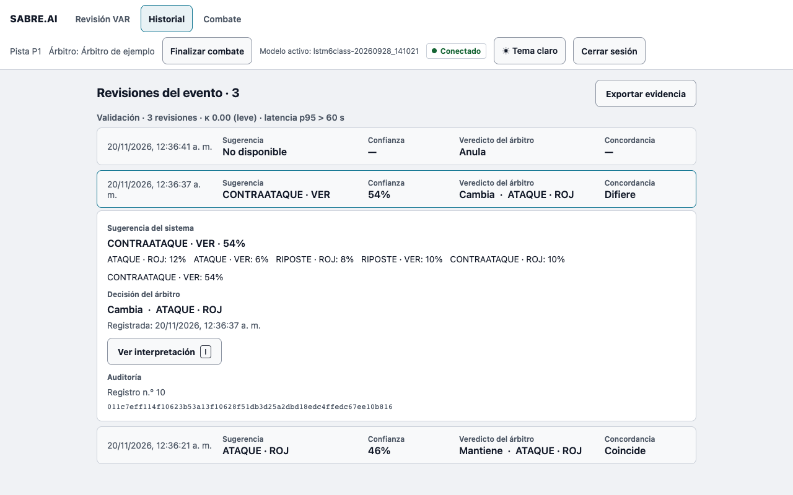

Si la carga falla: "No se pudo cargar el historial" o "No se pudo cargar el detalle de la revisión", con "Reintentar". Sin revisiones: "Sin revisiones registradas" y el botón "Ir a Revisión VAR".

### 4.8 Exportar la evidencia

1. En **Historial**, pulse **Exportar evidencia**.
2. Debe verse "Evidencia exportada: resumen-<evento_id>.json" y el navegador descarga el archivo.

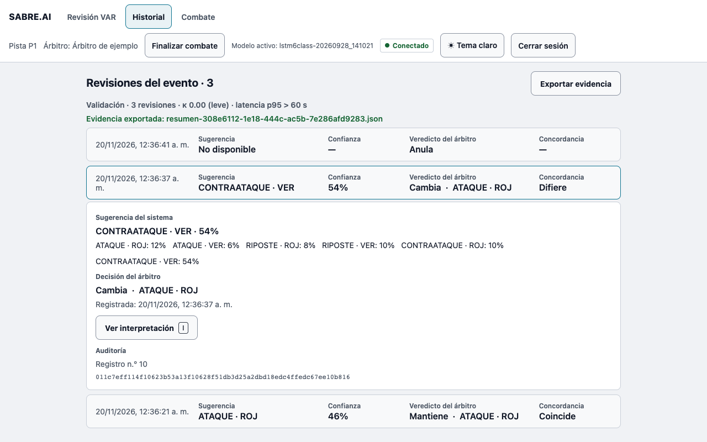

Si falla: "No se pudo exportar la evidencia" y "Reintentar". El archivo trae el resumen de la sesión de validación; solo cuentan las revisiones con veredicto:

| Campo | Cómo interpretarlo |
|---|---|
| `n_revisiones` | Revisiones con veredicto. |
| `no_disponibles.por_motivo` | Cuántas no tuvieron sugerencia, por motivo (sección 5). |
| `latencia` | Del envío del clip a la sugerencia. Umbral: p95 ≤ 60 000 ms. Una no disponible cuenta como más de 60 s; con `p95_ms` vacío y `p95_excede_umbral` verdadero, equivale a "> 60 s". |
| `latencia_inferencia` | Tiempo del clasificador por clip. Umbral: p95 ≤ 50 ms. |
| `kappa.kappa` y `kappa.banda` | κ de Cohen entre la sugerencia y la clase final, con su banda. `cumple` es verdadero con κ ≥ 0,61. |
| `kappa.calculable` falso | κ no calculable (`resumen.md` dice "no calculable"); `motivo` explica por qué. |
| `concordancia` | Porcentaje de revisiones donde la sugerencia coincide con la clase final. |
| `matriz_confusion` | Tabla de 6 por 6: filas, clase sugerida; columnas, clase final. |
| `integridad` | Resultado de la verificación de la cadena de auditoría. |

κ y la concordancia usan las revisiones con sugerencia y no anuladas (`n` de cada bloque). κ no es calculable con menos de 2 de ellas ni cuando hay una sola clase de ambos lados. Bandas de κ (Landis y Koch): < 0 pobre; 0 a 0,20 leve; 0,21 a 0,40 aceptable; 0,41 a 0,60 moderada; 0,61 a 0,80 sustancial; 0,81 a 1,00 casi perfecta. `revisiones.csv` y `resumen.md` los genera quien instala con `scripts/exportar_evidencia.py` ([`GUIA_EJECUCION.md`](GUIA_EJECUCION.md)).

### 4.9 Cerrar la sesión de validación (D-22, D-26)

Ningún clip se conserva después de la sesión. Al terminar:

1. Pulse **Combate**. Al pie, en la tarjeta **Cerrar la sesión de validación**, pulse **Cerrar sesión de validación** (necesita un combate activo: "No hay un combate activo" si no).
2. Lea el aviso: "Se hará el respaldo verificado de la sesión (sin los clips) y, solo si pasa, se borrarán los clips de video. Esto no se puede deshacer." Confirme con **Sí, respaldar y borrar los clips** o pulse **Cancelar**.

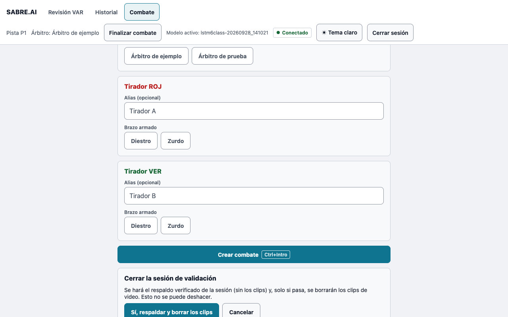

3. Mientras trabaja, la pantalla dice "Respaldando y verificando… no cierres esta página." Al terminar debe verse **✓ Sesión cerrada. Respaldo verificado; clips borrados: N.**

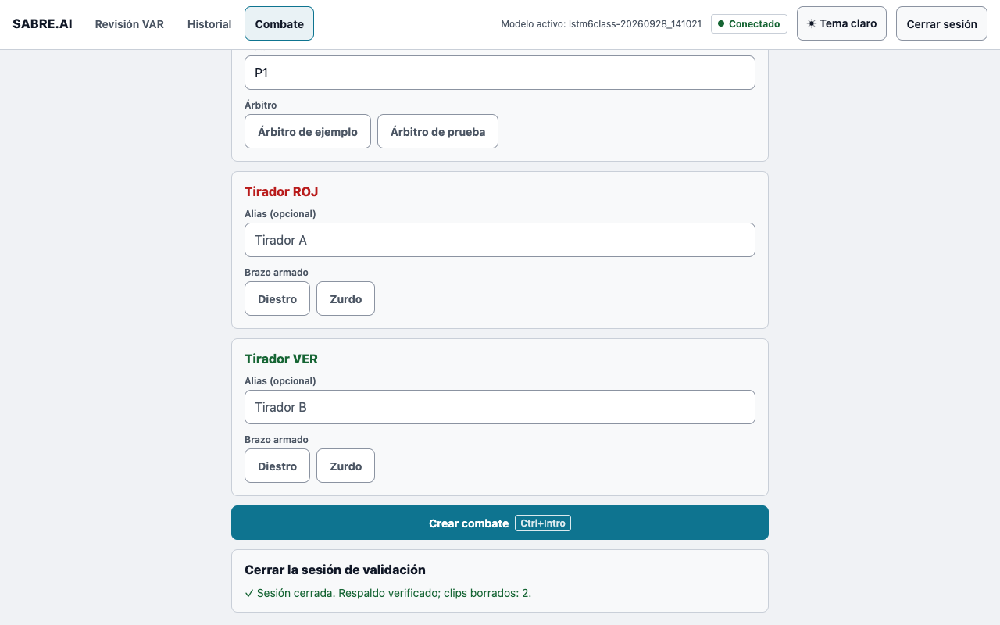

El combate activo se limpia: **Revisión VAR** vuelve a pedir configurarlo ("No hay combate activo").

Si el respaldo falla, **no se borra nada** y aparece "✕ La sesión NO se cerró y no se borró ningún clip." con el motivo y "Reintentar"; avise a quien instala el sistema. Un clip que otra sesión también usó (mismo hash) no se borra, así que `N` puede ser menor que el número de clips cargados. La base conserva el hash de cada clip y los metadatos, no el clip.

Para terminar un combate **sin** cerrar la sesión, pulse **Finalizar combate** en el encabezado: abre "Combate" sin combate activo y solo limpia el combate activo de la interfaz (no envía nada a Fog): las revisiones ya registradas siguen en la base y los clips no se tocan. Sin combate activo, "Revisión VAR" muestra "No hay combate activo" e "Historial", "No hay un evento activo".

### 4.10 Atajos de teclado

| Atajo | Acción |
|---|---|
| S | Elegir archivo. |
| R | Marcar la luz A en el instante actual del reproductor (con un clip cargado). |
| V | Marcar la luz B en el instante actual del reproductor (con un clip cargado). |
| Intro | ANALIZAR, cuando están completos los requisitos. |
| I | Ver interpretación (trazos y razonamiento), con una revisión abierta. |
| T / J | Abrir la interpretación en los trazos / en el razonamiento. |
| , y . | Cuadro anterior y siguiente (en el reproductor del clip y en los trazos). |
| A | Elegir "Anular la acción". |
| Esc | Borrar la elección de la decisión; con la interpretación abierta, cerrarla. |
| Ctrl+Intro | Crear combate. |

Los atajos sin Ctrl no actúan mientras escribe en un campo de texto, ni con Alt o Mayús, y con una vista abierta solo responden los de esa vista.

## 5. Estados y mensajes

### Motivos de "Clasificación no disponible"

| Motivo | Texto en pantalla | Qué significa | Qué hacer |
|---|---|---|---|
| `pose_incompleta` | "No se pudo detectar a ambos tiradores en el clip." | No se detectó a los dos tiradores, o el clip tiene menos de 3 fotogramas. | Siga el procedimiento VAR habitual. Verifique que el clip muestre a ambos tiradores y vuelva a cargarlo. Puede elegir la clase final o anular. |
| `confianza_baja` | "La confianza de la sugerencia quedó por debajo del umbral configurado." | La confianza no alcanzó el umbral. El sistema no produce este motivo porque el umbral no está definido. | Siga el procedimiento VAR habitual. |
| `clase_fuera_mvp` | "La acción detectada queda fuera de las 6 clases del sistema." | El sistema no produce este motivo. | Siga el procedimiento VAR habitual. |
| `timeout` | "El análisis superó el límite de 60 s." | No hubo respuesta a tiempo. | Siga el procedimiento VAR habitual. Puede volver a cargar el clip; si se repite, avise a quien instala. |
| `sin_senal_favero` | "No llegó la señal de la luz Favero." | Las luces se marcan a mano: el sistema no genera este motivo. | Siga el procedimiento VAR habitual. |
| `mensaje_invalido` | "El análisis recibió datos inválidos." | Un componente interno rechazó los datos del clip. | Vuelva a cargar el clip; si persiste, avise a quien instala. |
| Otro valor | "El sistema no pudo clasificar la acción." | Motivo no reconocido. | Siga el procedimiento VAR habitual y avise a quien instala. |

En todos los casos la pantalla agrega "Continúe con el procedimiento VAR habitual." y usted puede elegir la clase final o anular.

### "No revisado"

Es un estado de la rama `future/edge-favero` (tocado capturado sin revisión VAR). **No existe en `main`**: aquí toda revisión nace al pulsar ANALIZAR.

### Errores de la interfaz

Los errores del sistema se muestran como "Fog CÓDIGO: detalle", redactado por el sistema.

| Mensaje | Dónde | Causa y acción |
|---|---|---|
| "Error: no se pudo analizar el clip" | Revisión VAR | El sistema rechazó el clip o no hay conexión. Lea el detalle: 400, el archivo no abre como video o tiene menos de 3 fotogramas; 413, supera el tamaño máximo (200 MB por defecto); 422, falta la luz o el instante está fuera de la duración del clip; 404, el combate no existe; 503, no hay una versión de modelo activa. Corrija y pulse "Reintentar". |
| "No se pudo verificar el combate activo" | Revisión VAR | No se pudo comprobar el combate recordado. "Reintentar". |
| "No se pudo registrar el veredicto" | Revisión VAR | Un 409 indica que la revisión ya tiene veredicto o aún no tiene clasificación registrada. Vuelva a elegir la decisión. |
| "No se pudo cargar el catálogo" | Combate | No se leyeron eventos y árbitros. "Reintentar". |
| "No se pudo cargar el historial" / "…el detalle de la revisión" / "No se pudo exportar la evidencia" | Historial | Falló la lista, el detalle o la descarga. "Reintentar". |
| Pantalla "Iniciar sesión" de pronto | Cualquiera | La sesión caducó (8 h) o se cerró la pestaña. Vuelva a entrar. |
| "Sin conexión" | Encabezado | Fog no responde (sección 2). |

## 6. Clases tácticas

El modelo distingue 3 acciones para cada tirador, lo que da 6 clases. En "Historial" las acciones se escriben en mayúsculas.

| Clase en la interfaz | Tirador | Definición |
|---|---|---|
| Ataque · ROJ | A | Ataque del tirador A. |
| Ataque · VER | B | Ataque del tirador B. |
| Contraataque · ROJ | A | Contraataque del tirador A, simultáneo al ataque del rival. |
| Contraataque · VER | B | Contraataque del tirador B, simultáneo al ataque del rival. |
| Riposte · ROJ | A | Respuesta del tirador A después de parar el ataque del rival. |
| Riposte · VER | B | Respuesta del tirador B después de parar el ataque del rival. |

Estas definiciones describen la anotación del conjunto de datos con que se entrenó el modelo. El texto de las reglas FIE t.101 a t.105 no forma parte de esta documentación: consulte el reglamento vigente (FIE 2026). "Anular" cubre la acción simultánea: se anulan ambos golpes y se repone en guardia (t.106).

## 7. Limitaciones que debe conocer

La lista completa, con sus cifras y fuentes, está en [`LIMITACIONES.md`](LIMITACIONES.md). Lo esencial para usar la interfaz:

- La sugerencia es orientativa y **puede ser equivocada**: el F1 macro del modelo (0,4856 ± 0,0322, N = 10) no alcanza el umbral de aceptación (0,65). La decisión es del árbitro.
- Las luces y su instante los marca usted.
- Un clip a la vez, sin sincronía de dos cámaras.
- Clases y reglas corresponden solo a sable.
- La reproducción de video y la descarga del resumen están disponibles en la versión web.
- Los clips no se conservan tras cerrar la sesión.

## Anexo A. Trazabilidad

| Sección | CU | HU |
|---|---|---|
| 2 Acceso | RF-26 | N/A |
| 4.1 Configurar el combate | CU-01 | F-039 |
| 4.2 Cargar el clip y marcar las luces | CU-02, CU-03 | F-037, F-038 |
| 4.3 Solicitar la revisión | CU-05, CU-06 | F-030 |
| 4.4 Revisar la sugerencia | CU-07 | F-030, F-027 |
| 4.5 Interpretación | CU-08, CU-09 | F-031, F-035, F-008 |
| 4.6 Registrar la decisión | CU-10, CU-11 | F-033, F-034 |
| 4.7 Historial | CU-12 | F-034 |
| 4.8 Exportar la evidencia | CU-12 | F-034 |
| 4.9 Cerrar la sesión de validación | CU-11 | F-034 (D-22, D-26) |
| 5 Estados y mensajes | CU-06 | F-030 |
| 6 Clases tácticas | CU-06 | F-005 |

## Anexo B. Funciones fuera de esta versión

- CU-04 Capturar la acción en tiempo real (buffer circular, dos cámaras) y leer el aparato Favero por RJ12; solicitud VAR desde la pista, lista de tocados, decisión en pista y señal de prueba: fuera de `main` (solicitud de cambio del 20/11/2026; rama `future/edge-favero`).
- CU-05, flujo alterno: rechazo de la solicitud por el árbitro; no hay botón de rechazo.
- Revisión del clip de ambas cámaras con ±3 s alrededor del toque (F-006): la interfaz reproduce un solo clip (con avance cuadro a cuadro, F-007).
- La línea del arma (RF-18): no se dibuja (D-18).
- CU-12, filtros por combate, fecha y árbitro, y verificación del hash con marca de registro alterado: la pantalla muestra el hash pero no lo verifica.
- CU-13 Gestión de versiones del modelo desde la interfaz: se hace con `scripts/registrar_modelo.py`.
- CU-14 Reentrenamiento (T-018), CU-15 Calibración de cámaras (F-010), CU-16 Alertas de calidad de video (F-011): trabajo futuro o fuera de alcance.
- Procesamiento de varias pistas (RF-29) y reportes por sesión en PDF o CSV desde la interfaz (F-009): WON'T. El CSV de la sesión se genera con `scripts/exportar_evidencia.py`.
